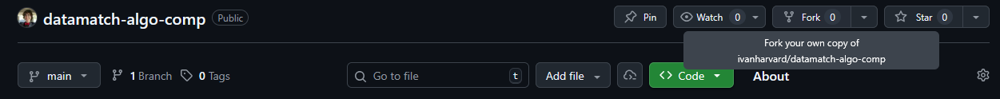
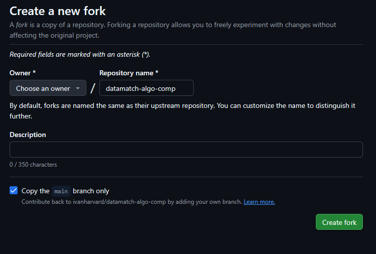
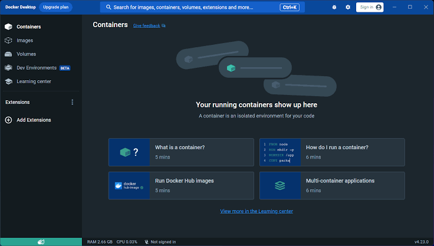

# Forking this repository

On the Github website, click this button:


You should see a screen like this:


Then, select "Choose an owner" and select your username.

Afterwards, click "Create fork."

You are now free to work on this fork. Be sure to sync with my repository when
a new assignment drops.

# Completing an assignment

If a new assignment is released, sync with my repository. You should see a new
folder being added to your repository upon syncing. This is the new assignment
and is labeled something like `comp1` or `comp2` or `comp3`. Let's focus on
`comp1` for now.

Inside `comp1`, you should be able to see some files you were provided with. One
of those files is the `README.md` with instructions on how to complete the
assignment and instructions on how to check your work.

You aren't required to pass all the tests. This work is entirely completion 
based, but you're still encouraged to run `check50` on your work. 

You can see how we're testing you in two ways:
1. Read `__init__.py`. This is the `check50` file we use to check your work.
2. Read any file inside the `tests/` folder. This is what `check50` will run to
compare your outputs against a known set of answers.

# Requirements

You'll probably want to install [`VSCode`](https://code.visualstudio.com/) if
you haven't already.

You'll probably want to install [`Github Desktop`](https://desktop.github.com/download/)
(or just use `Git` if more comfortable).

Now, we'll set up something called `Docker`. It will allow us to have a consistent environment for grading and compiling your code.

## Windows Users

You'll probably want to install Windows Subsystem for Linux (WSL). Run:
```powershell
wsl --install
```
and then answer the questions that pop up. Enter in a username and password of
your choice, but just make sure you remember it.
Wait until it finishes installing, and once you see something like:
```text
ivan@IG:/mnt/c/Users/ivang/Documents/github/datamatch-algo-comp/$
```
then you're on the right track! You can run:
```bash
exit
```
to exit WSL. Now type
```powershell
wsl
```
to enter WSL again.

Now, continue to the section `Installing Docker`.

## Installing Docker

Docker creates a layer above your operating system (called a "container"). Programs running in this container have the correct requirements for our assignments, and believe they are running on their own operating system.

You can think of it as a lightweight virtual machine.

### Windows/MacOS Users

You will need to install something called [Docker Desktop](https://www.docker.com/products/docker-desktop/). Download it and follow the instructions.

When using any Docker commands, Docker Desktop must be open. If you get an error
like
```text
Cannot connect to the Docker daemon at unix:///var/run/docker.sock. Is the docker daemon running?
```
then this is a sign that Docker Desktop is not open or must be restarted.

You should see a screen like this when it's set up.


### Linux Users

The installation process depends on your distro. But in general, you will install the Docker daemon using whatever package manager you use. For example, these are the steps for installing Docker using `pacman` in `bash`.
```bash
sudo pacman -S docker docker-buildx
sudo systemctl enable --now docker.service
sudo usermod -aG docker $USER
```
Log out and back in afterwards so the `docker` group change takes effect.

## Using Docker

**Windows users: run these commands from a WSL terminal.**

1. In the root of your fork, build the image (only needed once):
   ```bash
   ./docker/build.sh
   ```
2. Start a shell inside the container:
   ```bash
   ./docker/run.sh
   ```
   If you see
   ```bash
   student@datamatch:/workspace$
   ```
   then Docker worked!
3. You're now in `/workspace`, which is your repo. Edits you make in VSCode
   show up inside the container right away. Run `make` and `check50` from
   here as the assignment instructions describe, e.g.
   ```bash
   student@datamatch:/workspace$ cd comp1
   student@datamatch:/workspace/comp1$ check50 ivanharvard/datamatch-algo-comp/main/comp1 --local
   ```

## Using Git

Commit, push, and sync your fork from GitHub Desktop (or the Source Control tab
in VSCode) on your own computer, not inside Docker. Docker uses the same files,
so anything you change in the container shows up in GitHub Desktop right away.

You can also commit from inside the container, since `./docker/run.sh` passes
in the name and email from your computer's git settings. You can't push from
inside the container, because your GitHub login isn't there. Push from GitHub
Desktop instead.

If committing inside the container says `Please tell me who you are`, set your
name and email outside Docker (in WSL on Windows), using the email on your
GitHub account. Then run `./docker/run.sh` again.
```bash
git config --global user.name "Your Name"
git config --global user.email "you@example.com"
```

**Windows users:** if `git status` inside the container lists files you didn't
change, that's because Windows and Linux end lines of text differently. Don't
commit those files. Use GitHub Desktop for git instead.
